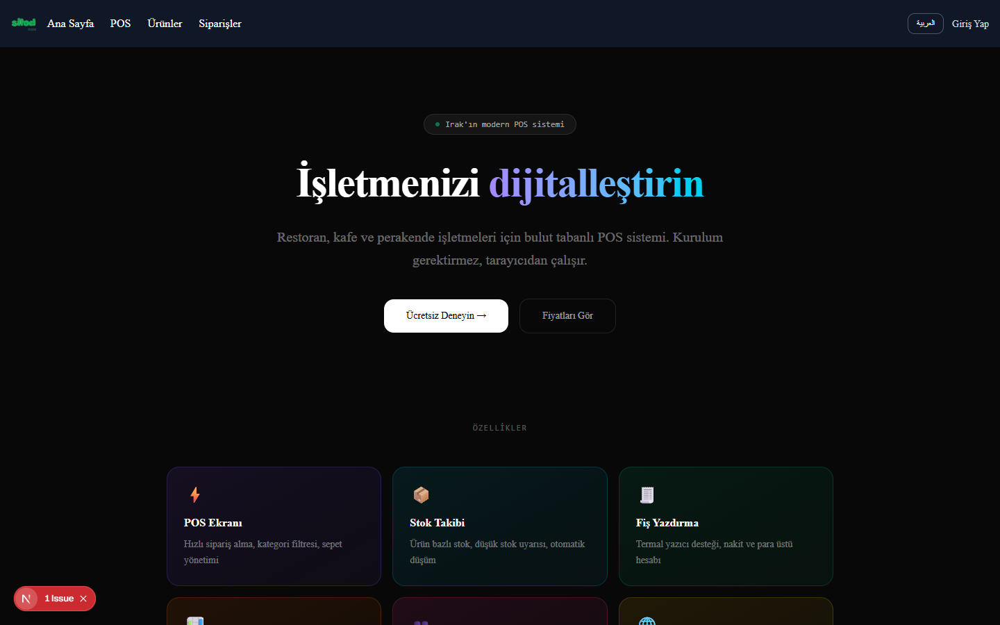

# 🧾 Bulut Tabanlı Modern POS & Restoran Otomasyon Sistemi (`pos-app`)



Restoran, kafe ve perakende işletmeleri için kurulum gerektirmeden doğrudan tarayıcı üzerinden çalışan **bulut tabanlı POS (Point of Sale) ve işletme yönetim sistemi**. Hızlı sipariş alma, masa yönetimi, stok takibi, fiş yazdırma, satış raporları ve Türkçe / Arapça çoklu dil desteği sunar.

---

## ✨ Öne Çıkan Özellikler

- **⚡ Hızlı POS Ekranı (`/pos`):** Kategori bazlı ürün filtreleme, hızlı sepet yönetimi ve nakit / para üstü hesaplama.
- **🪑 Masa Yönetimi (`/masalar`):** Restoran ve kafeler için anlık masa durumu ve adisyon takibi.
- **📦 Ürün ve Stok Takibi (`/urunler`):** Ürün bazlı stok yönetimi, düşük stok uyarıları ve otomatik stok düşümü.
- **🧾 Siparişler & Fiş Yazdırma (`/siparisler`):** Termal yazıcı uyumlu fiş çıktısı ve geçmiş sipariş takibi.
- **📊 Yönetim Paneli & Raporlar (`/dashboard`, `/rapor`):** Günlük/aylık ciro, en çok satan ürünler ve performans analizleri.
- **👥 Çoklu Kullanıcı & Rol Yönetimi (`/kullanicilar`):** Kasiyer, garson ve yönetici yetkilendirmesi (`NextAuth.js`).
- **🌐 Çoklu Dil Desteği:** Türkçe ve Arapça (RTL) arayüz desteği.

---

## 🛠️ Kullanılan Teknolojiler

| Kategori | Teknoloji |
| :--- | :--- |
| **Çatı (Framework)** | Next.js 16 (App Router & Turbopack), React 19 |
| **Veritabanı & Backend** | Supabase (`@supabase/supabase-js`), Next.js API Routes |
| **Kimlik Doğrulama** | NextAuth.js v4, bcryptjs |
| **Stil & UI Bileşenleri** | Tailwind CSS v4, shadcn/ui, Radix UI, Lucide Icons |
| **Derleyici & Araçlar** | React Compiler (`babel-plugin-react-compiler`), ESLint 9 |

---

## 📂 Proje Klasör Yapısı

```text
pos-app/
├── app/
│   ├── api/              # Kimlik doğrulama ve veri işlemleri için API rotaları
│   ├── components/       # Sayfa içi özel bileşenler
│   ├── dashboard/        # Yönetici özet paneli
│   ├── fiyatlar/         # Abonelik ve paket fiyatlandırma sayfası
│   ├── giris/ & kayit/   # Kullanıcı giriş ve kayıt ekranları
│   ├── kullanicilar/     # Personel ve yetki yönetimi
│   ├── locales/          # Türkçe ve Arapça dil dosyaları
│   ├── masalar/          # Restoran masa düzeni ve adisyon takibi
│   ├── pos/              # Hızlı satış (POS) terminali ekranı
│   ├── rapor/            # Satış ve stok raporları
│   ├── siparisler/       # Sipariş geçmişi ve yönetimi
│   └── urunler/          # Ürün ve kategori yönetimi
├── components/ui/        # Yeniden kullanılabilir shadcn/ui bileşenleri
├── lib/                  # Supabase istemcisi ve yardımcı fonksiyonlar
├── public/               # Statik varlıklar ve uygulama ekran görüntüleri
│   └── screenshots/
│       └── preview.png   # Uygulama önizleme görseli
└── package.json          # Proje bağımlılıkları ve betikler
```

---

## 🚀 Kurulum ve Çalıştırma

### Gereksinimler

- **Node.js:** `>= 18.x` (veya `20.x+`)
- **npm**
- **Supabase Projesi** (Veritabanı bağlantısı için)

### Adımlar

1. **Depoyu klonlayın:**
   ```bash
   git clone https://github.com/Sermedsefaa/pos-app.git
   cd pos-app
   ```

2. **Bağımlılıkları yükleyin:**
   ```bash
   npm install
   ```

3. **Ortam değişkenlerini yapılandırın:**
   Proje kök dizininde `.env.local` dosyası oluşturun ve Supabase / NextAuth bilgilerinizi ekleyin:
   ```env
   NEXT_PUBLIC_SUPABASE_URL=your_supabase_url
   NEXT_PUBLIC_SUPABASE_ANON_KEY=your_supabase_anon_key
   NEXTAUTH_SECRET=your_nextauth_secret
   NEXTAUTH_URL=http://localhost:3000
   ```

4. **Geliştirme sunucusunu başlatın:**
   ```bash
   npm run dev
   ```
   Tarayıcınızda `http://localhost:3000` adresini açarak uygulamaya erişebilirsiniz.

---

## 📄 Lisans

Bu proje eğitim ve ticari portfolyo amaçlı geliştirilmiştir.
